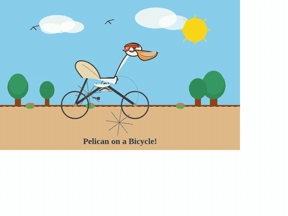

# Pelican test

## A pelican riding a bicycle

Pi, DeepSeek Harness, and OpenCode each received exactly this user prompt:

> Create a self-contained animated SVG of a pelican riding a bicycle. Use SVG-native animation without JavaScript or external resources. You may use the available rendering and image tools to inspect frames at times you choose and improve your work as needed.

| Environment | Configuration |
| --- | --- |
| OS | Ubuntu 24.04 LTS |
| GPU / VRAM | NVIDIA GeForce RTX 5060 Ti / 16 GB |
| System RAM | 32 GB |
| CUDA | 13 |

The clients have image input, native tools, and the Rust `read_image` MCP tool
for animated SVG frames. They decide whether to render, read images, or revise
their work. No inspection requirement, follow-up task, or corrective feedback
is supplied. Previews preserve their original outputs, including defects.
Qwen3.6 outputs have visible geometry failures; Qwen3.8 / Pi is selected as a
coherent display result.

Shared settings: 65,536-token context, 57,344-token output cap, thinking enabled,
temperature 1.0 / top-p 0.95 / top-k 20, presence penalty 0.5, and seed 42.
All clients request `xhigh`: Qwen3.8's template interprets that effort level;
Qwen3.6's template only uses the thinking switch. Qwen3.8 uses host weight
placement to make room for the larger context.

### Qwen3.6-35B-A3B-2Bit-GSQ

Native GSQ checkpoint with vision weights; MTP disabled.

| Pi | DeepSeek Harness | OpenCode |
| :---: | :---: | :---: |
|  |  |  |
| **179.09 s** | **819.58 s** | **262.35 s** |
| Image input: Yes | Image input: Yes | Image input: Yes |

### Qwen3.8-27B-GSQ-RCO-IQ2_XS-mtp.gguf

IQ2_XS GGUF with its matching BF16 vision projector; native stochastic
MTP enabled with a draft length of one.

| Pi | DeepSeek Harness | OpenCode |
| :---: | :---: | :---: |
|  |  |  |
| **2633.67 s** | **5461.41 s** | **5107.25 s** |
| Image input: Yes | Image input: Yes | Image input: Yes |

Agent time includes native client preparation through task exit, tools, and
client-initiated retries. OpenCode includes private server/MCP startup. Model
preparation and independent post-run review are excluded. Client system prompts
and execution trajectories differ, so these times do not establish a general
speed ranking. Image usage means actual image payloads reached the
inference service. Successful delivery and visual quality are separate findings;
The sections below provide observations, preparation times, configuration,
and reproduction steps.

## Protocol

Run both models with Pi, DeepSeek Harness, and OpenCode in fresh native
sessions and empty workspaces. Send the exact prompt once, retaining native
system prompts and tools. Register `lia image-tools`
through each client's native MCP configuration. Supply no additional system
instructions about rendering or inspection. Agents decide whether to inspect,
which animation times to sample, and whether to revise. Supply no corrective
feedback or manual repairs.

Verify vision capability separately, in fresh sessions, using an animated SVG
with a red circle moving from left to center and a fixed blue square. Ask each
client to read its default frame and a frame at two seconds. Check that actual
PNG payloads reach inference and that the answer distinguishes the positions.
This establishes the tested capability, not general visual judgment; these
reads do not count as autonomous pelican inspection.

Run cases serially with a fresh inference service for each. Keep failed or
interrupted diagnostics separate, including their configuration and reason
for exclusion. Use one frozen engine and image-tool binary throughout.

## Results

All six native workflows completed with actual image input and no inference
errors. Qwen3.8 / Pi is selected as a coherent display result. Workflow
completion, image use, and visual quality remain separate findings.

| Model | Agent | Preparation | Agent time | Exit | Requests | Inference errors | Image requests | Unique images |
| --- | --- | ---: | ---: | ---: | ---: | ---: | ---: | ---: |
| Qwen3.6 GSQ | Pi | 13.85 s | 179.09 s | 0 | 6 | 0 | 4 | 4 |
| Qwen3.6 GSQ | DeepSeek Harness | 13.85 s | 819.58 s | 0 | 21 | 0 | 17 | 11 |
| Qwen3.6 GSQ | OpenCode | 14.05 s | 262.35 s | 0 | 17 | 0 | 14 | 4 |
| Qwen3.8 IQ2_XS | Pi | 8.43 s | 2633.67 s | 0 | 5 | 0 | 3 | 5 |
| Qwen3.8 IQ2_XS | DeepSeek Harness | 8.43 s | 5461.41 s | 0 | 9 | 0 | 5 | 6 |
| Qwen3.8 IQ2_XS | OpenCode | 8.43 s | 5107.25 s | 0 | 13 | 0 | 8 | 11 |

Image requests include repeated images in history; unique images count distinct
payloads. All six model/client capability checks completed with actual image input
and correct color/direction descriptions. Approximate coordinates were not
uniformly precise, so this is not a geometry-accuracy claim.

### Independent visual observations

Final SVGs were archived unchanged after native exit and sampled independently
at 0, 0.5, 1, 2, and 3.5 seconds. Qwen3.8 / Pi was also checked at 5, 10,
30, and 60 seconds. These are requested capture times with browser scheduling
latency, not exact SMIL seeks.

- **Qwen3.6 / Pi:** Detached wing/body parts and stray spokes below the bicycle.
- **Qwen3.6 / DeepSeek Harness:** The head is detached from the torso; the bicycle remains connected.
- **Qwen3.6 / OpenCode:** The wheels are displaced to the upper-left corner, away from the frame on the road.

- **Qwen3.8 / Pi:** Selected as a coherent display result. The rider, frame, and centered wheels remain together through the extended samples. Scenery, wheels, and crank animate, but the legs remain static and do not follow the pedals. The bill/pouch and anatomy are stylized.
- **Qwen3.8 / DeepSeek Harness:** The rider, frame, and wheels remain connected. Legs are disproportionately long, the bill/pouch is simplified, and the chain points toward the front wheel. The agent autonomously read frames, made six edits to the crank/leg/foot geometry, and reread four frames.
- **Qwen3.8 / OpenCode:** The bicycle remains connected and the legs cycle, but the bird's body is very thin and its neck elongated. The agent computed linkage keyframes, read images, revised the legs and cloud motion, and checked more frames. Its native context checkpoint and subsequent continuation remain included in task time.

All six delivered standalone SVG-native animation without scripts or external
references. The Qwen3.6 outputs retain visible geometry failures; none is selected
as a clean display result. These are qualitative observations, not an official
visual score or a claim of physically exact anatomy or mechanics. Previews
preserve the original outputs, including defects.

## Configuration

| Setting | Value |
| --- | --- |
| OS / GPU / RAM / CUDA | Ubuntu 24.04 LTS / RTX 5060 Ti 16 GB / 32 GB / CUDA 13 |
| Clients | Pi 1.3.0; DeepSeek Harness 0.2.0-rc.2; OpenCode 2.0.32 |
| Node.js | 24.19.0 |
| Context / configured output cap | 65,536 / 57,344 tokens |
| Thinking | Enabled; all clients request xhigh |
| Sampling | Temperature 1.0, top-p 0.95, top-k 20, seed 42 |
| Other sampling | Presence penalty 0.5; repetition penalty 1; min-p 0 |
| Prefill / image budget | 512 tokens / 256–512 image tokens |
| Qwen3.6 MTP / host experts | Disabled / none |
| Qwen3.8 MTP / host weights | Stochastic, one draft / embedding and last four main layers |
| Timeout | 14,400 seconds per native CLI invocation |
| DeepSeek Harness semantic stream idle | Native 300-second default for GSQ; 14,400 seconds for GGUF |

Qwen3.6 uses [ISTA-DASLab/Qwen3.6-35B-A3B-2Bit-GSQ](https://huggingface.co/ISTA-DASLab/Qwen3.6-35B-A3B-2Bit-GSQ),
revision `543019cbe7d10f6d2e78d4017606a42bd50ea7e9`, including vision weights.
Its template uses the thinking switch but has no separate effort levels.
Qwen3.8 uses `Qwen3.8-27B-GSQ-RCO-IQ2_XS-mtp.gguf` with
`mmproj-Qwen3.8-27B-BF16.gguf`; its template interprets xhigh.

Sampling is aligned across all six runs. Presence penalty 0.5 is an explicit
shared anti-repetition setting.

Clients may lower output limits to fit available context; native auxiliary
requests retain their own caps. These limits and truncations are recorded in
the raw requests and responses. The same engine binary is used throughout:
`31acd3caf0912b262e8b9a5530833317154bbe8c2d708286e361c27bad5ddf14`.

## Reproduction

Build with the pinned Rust toolchain and NVIDIA CUDA Rust:

```sh
cargo oxide build --arch sm_120 -- --release --features cuda,image-tools --bin lia
```

Install the native clients in an external `TEST_ROOT`:

```sh
npm install --prefix "$TEST_ROOT/runtime" \
  @earendil-works/pi-coding-agent@1.3.0 \
  @deepseek-ai/dsh@0.2.0-rc.2 @opencode/cli@2.0.32
export PATH="$TEST_ROOT/runtime/node_modules/.bin:$PATH"
export LIA_CUDA_GRAPH=1 LIA_PREALLOCATE=1 LIA_VISION_OFFLOAD=1
export LIA_ATTN_MMA_DECODE=1 LIA_ATTN_QUERY_TILES=1 LIA_GDN_PARALLEL=0
export LIA_PREFILL_TILE=128 LIA_PREFILL_BATCH=512
export LIA_DEFAULT_TEMPERATURE=1.0 LIA_DEFAULT_PRESENCE_PENALTY=0.5
```

Start the service with the Hugging Face Qwen3.6 directory:

```sh
LIA_MTP_DRAFT_MAX=0 LIA_MOE_HOST_EXPERTS=0 \
  target/release/lia serve "$MODEL" 18473 65536
```

Or start the GGUF Qwen3.8 service with its projector:

```sh
LIA_MTP_DRAFT_MAX=1 LIA_MTP_SAMPLING=stochastic \
LIA_HOST_EMBEDDING=1 LIA_HOST_LAYERS=4 \
LIA_PREFILL_FP8=1 LIA_PREFILL_WEIGHT_PREPACK=0 \
LIA_MM_ROWS=2 LIA_SPLIT_K=1 LIA_MM_THREADS=128 LIA_INT8=1 \
  target/release/lia serve "$MODEL" 18473 65536 --mmproj "$PROJECTOR"
```

Wait for `/health`; check image support, thinking, MTP mode, prefill batch, and
image budget. Vision weights and attention storage exchange GPU residency by
phase. All model operators still execute in Rust CUDA.

Connect each native client's OpenAI-compatible provider to
`http://127.0.0.1:18473/v1`. Declare text and image input, tools and reasoning,
the common context/output limits, and the sampling above. Pi and DeepSeek
Harness use `openai-completions`; OpenCode uses
`@opencode/ai/providers/openai-compatible` with
`compatibility.reasoningField: reasoning_content`. Map Pi's xhigh and
DeepSeek Harness's max effort to xhigh; send xhigh through OpenCode's provider
body. Explicit sampling and matching service defaults must agree.
Set `max_completion_tokens: 57344` explicitly in OpenCode's provider body.
For the slower GGUF Harness run, set `streamIdleTimeoutMs: 14400000` under
`llm-pi-ai.config.providers.lia-local`. Its semantic-event watchdog is separate
from HTTP keepalives. The extension changes waiting policy without changing
inference settings.

Use separate native homes, sessions, and workspaces for every case. Isolate
`PI_CODING_AGENT_DIR`, `DSH_HOME`, and OpenCode configuration/XDG paths; set
`PWD` to the workspace and disable OpenCode model metadata fetching. Register
`lia image-tools` through each client's native MCP configuration. Start a fresh
private OpenCode server and wait for its native MCP catalog to report the
image tool connected before sending the task. This preparation sends no model
request and supplies no extra prompt.

```sh
pi --provider lia-local --model "$MODEL_ID" --thinking xhigh \
  --mode json --no-skills --no-context-files \
  --session-dir "$TEST_ROOT/pi-sessions" --print "$PROMPT"
dsh headless --patch "$TEST_ROOT/lia.yml" --json "$PROMPT"
opencode run --server "$PRIVATE_SERVER_URL" --auto \
  --model "lia-local/$MODEL_ID" --format json "$PROMPT"
```

## Measurement and review

Measure model preparation from fresh inference service launch to health
readiness. Measure agent time from native client preparation to task exit,
including native server/MCP startup, inference, tools, and client retries.
Pi and Harness startup occurs within their CLI invocation. OpenCode's reported
time also includes its private server and MCP readiness preparation; record
CLI-only time separately. Exclude model preparation, post-exit background drain,
and independent review from agent time. Native trajectories differ, so these
times do not establish a general speed ranking.

Keep requests, actual parameters, streams, errors, termination reasons, tool
calls, original file hashes, and binary identity outside Git. If an agent writes
outside its workspace, verify the file against a completed native write and
archive the unchanged bytes before another case can overwrite it.

Independently render multiple animation times after exit, inspect the geometry,
and check scripts and external references. The image tool samples elapsed
browser time with normal scheduling latency; it does not promise exact SMIL
seeking. Verify that capture leaves source bytes unchanged. Supply no review
feedback to the agent. Only compact GIF previews and documentation enter Git;
SVGs, PNGs, raw records, logs, model weights, and secrets remain outside.

## Preview assets

The six GIFs total 801,900 bytes (about 783 KiB). Each is a four-second excerpt
at 480×360 and 6 fps, using 48 colors and looping for display. Captures preserve
the full 960×720 viewport, including any white margin in the original SVG.
The preview loop is not a claim that every animation shares a four-second cycle.
Encoding changes size and palette, with no manual geometry repairs.

| Model | Pi | DeepSeek Harness | OpenCode |
| --- | --- | --- | --- |
| Qwen3.6 GSQ | [Preview](qwen3.6/pi.gif) | [Preview](qwen3.6/deepseek-harness.gif) | [Preview](qwen3.6/opencode.gif) |
| Qwen3.8 IQ2_XS | [Preview](qwen3.8/pi.gif) | [Preview](qwen3.8/deepseek-harness.gif) | [Preview](qwen3.8/opencode.gif) |
